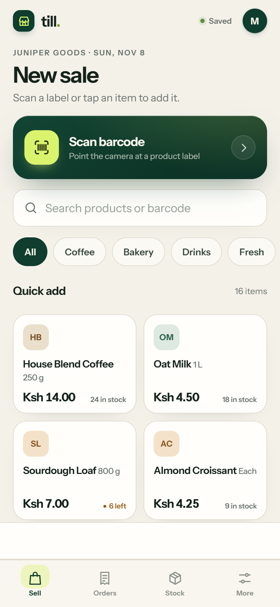
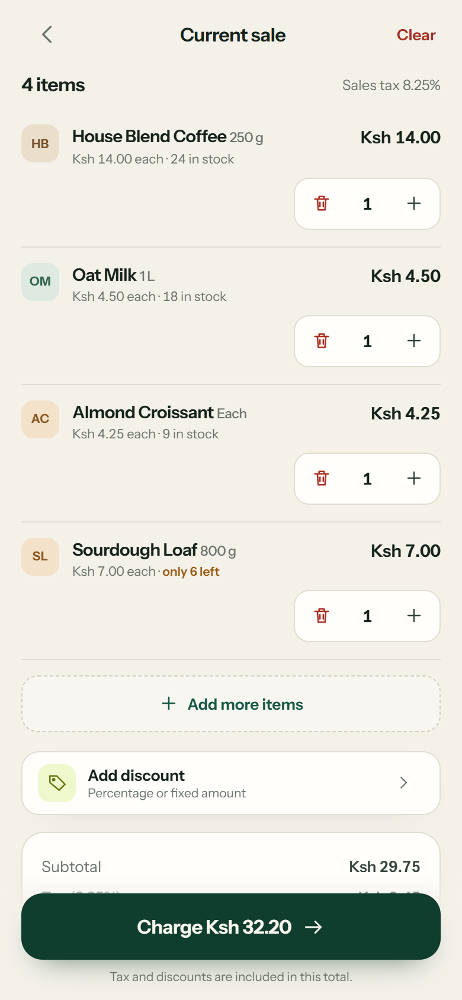
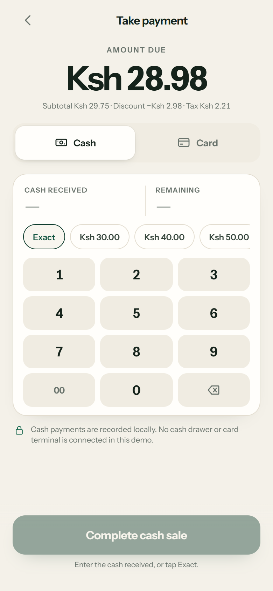
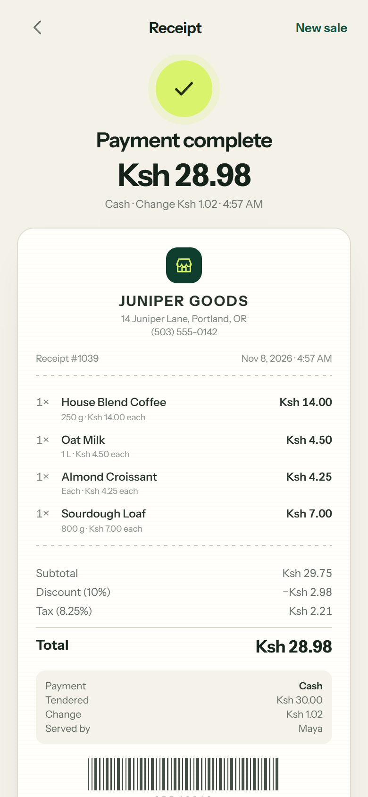

# Biller POS — one-handed point of sale

Biller POS is a small, fast POS web app for a single shop counter. It runs entirely in the browser: scan a barcode, build a sale, take cash or a simulated card payment, and keep products, stock, orders, and receipts on the device.

Built as a mobile-first PWA with plain HTML, CSS, and JavaScript — no build step, no backend.

A **fresh install starts empty**. There is no demo catalog, no sample orders, and no seed stock: the shop adds its own products from the Stock tab on day one.

| Sell | Cart | Payment | Receipt |
| --- | --- | --- | --- |
|  |  |  |  |

## Run it

From this folder:

```bash
python -m http.server 4173 --bind 127.0.0.1
```

Open <http://127.0.0.1:4173/>.

A local server is required for the camera, service worker, and install prompt. Camera access also works on any HTTPS deployment. Opening `index.html` from disk (`file://`) shows the scanner’s “not available” state and still allows manual barcode entry.

To use it like an app, open the browser menu and choose **Install app** / **Add to Home Screen**. The service worker caches the shell and sample fonts, so it opens offline after the first load.

## Run it natively on Android

A Capacitor-based Android wrapper lives in `../biller android pos` (this folder, `biller pc pos`, is the web app).

```bash
# from biller android pos
npx @capacitor/cli sync android
npx @capacitor/cli build android   # -> android/app/build/outputs/apk/debug/app-debug.apk
npx @capacitor/cli run android     # build + install to a connected device/emulator
```

Open the `android` folder in Android Studio (**File → Open…**) and use **Build → Build APK(s)**.

Notes:
- The native shell declares `CAMERA` + `INTERNET` permissions; the WebView serves the app over a
  local secure server, which is required for camera access on Android.
- For camera testing on a real device, the phone and this machine must be on the same network and the
  local server must be reachable.
- Installed APK data lives in the app's own storage (same single-device model as the PWA).
- `npx @capacitor/cli build android` needs release signing options (keystore path, keystore password,
  key alias, key password). For a local build use `gradlew assembleDebug` instead — it needs no
  credentials.

## Your first day in the app

1. **More → Settings** sets the store name, address, phone, staff name, sales tax, currency, and the
   receipt footer. Save the form and the details appear on every receipt.
2. **More → Categories** is where the product groups live. Add, rename, or delete them — the Sell
   screen chips and the product editor both follow the list straight away.
3. **Stock → Add** creates a product. Fill in the name, size, price, stock, low-stock threshold, and
   pick a category. The barcode field has its own camera button.
4. **Sell** is the home screen. Tap **Scan barcode** and point the camera at a label, or tap a product
   card to add one unit.
5. Open the cart, apply a discount if you need one, then **Charge**.
   - Cash: tap **Exact** or a quick amount, then **Complete cash sale**. Change is calculated.
   - Card: **Start demo payment** waits about two seconds and returns a simulated approval.
6. The receipt screen shows the sale, payment details, and a scannable receipt code. When the sale is
   finished the cart is **cleared automatically** and the sold units come off the shelf.

**Orders** keeps the history, **Stock** edits the catalog, and **More** holds the settings, categories,
and data controls.

## Screens and flows

### Sell — the home screen
A scan action, search field, category chips, and a two-column product grid. Product cards show price and
stock state (in stock, “6 left”, “Sold out”), plus a badge for items already in the cart. Tapping a card
adds one unit. A persistent cart dock appears above the tab bar and opens the cart.

With an empty catalog the screen shows a **No stock yet** panel with a shortcut to **Add your first
item**, rather than an empty grid.

### Back button and swipe-back
**Sell is the home of the app.** The Android back button and the swipe-back gesture always land on Sell
first, no matter which screen you were on. Pressing back a second time while already on Sell opens a
**Close Biller POS?** prompt with **Keep selling** and **Close app**. An open sheet (discount, product
editor, category editor, exit prompt) closes first before anything else happens.

Internal navigation uses the History API rather than `location.hash`, because changing the hash also
raises a `popstate` event and that used to look like a back gesture.

### Scanner
A full-screen camera view with a scan reticle, torch button when the device supports it, and four clear
states:

- **Starting** — camera is opening.
- **Camera access is off / unavailable** — explains the problem and offers manual entry or retry.
- **Scanning** — native `BarcodeDetector` where available, local ZXing as the fallback.
- **Not in catalog** — shows the scanned code and offers **Add as new product** or **Scan again**.

Manual entry is always one tap away. Scans are de-duplicated for 2.4 seconds so one label does not add
several units.

### Inline scan bar (stock entry)
Inside the product editor the barcode field has a camera button that opens a **small camera window under
the field**, not a separate screen. The entry form stays exactly where it was, so every detail already
typed — name, size, price, stock, category — is still there when the scan finishes. The scanned code is
written straight into the barcode field and the window closes itself.

### Cart
Line items with quantity steppers, per-line totals, stock warnings, and an “Add more items” shortcut. The stepper is capped at available stock; reducing the last unit removes the line. Orders, discounts, and totals are shown below, with a sticky charge button that always shows the amount due.

### Discounts
Quick 5 / 10 / 15 / 20% buttons, plus a custom percentage or fixed amount. Discounts are order-level, cannot exceed the subtotal, and are removed automatically if the cart is emptied.

### Payment
The amount due, a cash/card segmented control, and a breakdown of subtotal, discount, and tax.

- **Cash** has an Exact chip, rounded quick amounts, a large keypad, live cash received/remaining or change due, and a completion button that stays disabled until enough cash is entered.
- **Card** is explicitly labelled as a demo. It collects no card data and simulates approval after about two seconds.

### Receipt
A just-paid success state followed by a paper-style receipt with store details, line items, subtotal, discount, tax, total, payment method, tendered/change or demo card reference, staff name, and a receipt barcode. Past receipts keep a snapshot of the store details used at the time of sale. Receipts can be shared as text or printed.

### Orders
Today’s sales total, order count, and cash/card split. Orders are grouped by Today / Yesterday / date and can be filtered by payment method. Tapping an order opens its stored receipt.

### Inventory
Product count, low-stock count, retail value, and an out-of-stock banner. Out-of-stock items sort first, then low-stock, then alphabetical. Each row has a quick stock stepper and opens the product editor. The editor supports name, size/variant, price, stock, barcode, category, low-stock threshold, and deletion. The barcode field can be filled by the camera or by the inline scan bar. The list has stock filters — **All**, **Low stock**, and **Out of stock** — so low-stock items can be reviewed in one place (low stock means stock is above zero but at or below the low-stock threshold).

### Categories
Categories live in the saved state, not in the code, so the shop controls them. The **More** tab has a
**Categories** card with one row per category: a colour swatch, the name, how many products are in it, a
rename button, and a delete button.

- **Add category** opens a small sheet; blank names and duplicates (case-insensitive) are rejected with a
  message in the form.
- **Rename** carries the products in that category over to the new name.
- **Delete** asks first. Products in the deleted category move to another category so nothing is orphaned.
  The last remaining category cannot be deleted.

Custom categories get a steady colour of their own, so the same category always looks the same on every
product card.

### Account (email sign-in + gate)
The app requires an email sign-in before it can be used. The Settings screen includes an email sign-in (email + password) with a session kept on the device under `till.pos.auth`. The router redirects unauthenticated visitors to an **Auth** gate screen; signing in returns to the Sell screen.

### Cloud backup (Firebase Firestore)
The shop always lives on the device, so selling never stops when the network does. When an account is signed in, the same state is mirrored to **Cloud Firestore** (`billerShops/{uid}`) and pulled back down on sign-in, so the till can be opened on another device. Every change is saved locally first and pushed to the cloud a moment later; the newer copy wins when two devices have the shop open.

- **Sync now** (Account screen) fetches the cloud copy by hand. There is no pull-to-refresh gesture: the app pushes every change to the cloud by itself and pulls the cloud copy when it starts.
- **Account → Cloud backup** shows whether the shop is on Firebase or only on this device, when it last synced, and a **Sync now** button.
- Each signed-in account leaves a **presence** record (`billerPresence/{uid}`) with its email, app version and last-seen time. Only the developer account can read that list, and the **Account** screen then shows *Signed-in accounts* with who is online right now.

Firestore still has to be switched on for the project — see [FIREBASE-SETUP.md](FIREBASE-SETUP.md) for the two steps and the security rules.

### Settings (More)
Store name, address, phone, staff name, sales tax, **currency**, and receipt footer. The currency defaults to **KES (Kenyan shillings, KSh)** and can be changed — all totals, receipts, discounts, cash change, and quick-cash amounts use it. Data controls export a JSON backup or reset the shop. “Where is my data?” explains local storage. An **Email sign-in** row opens the sign-in sheet; when signed in it shows the email and offers sign-out.

**Reset all data** clears every product, order, and setting and returns the app to an empty shop with the default category list.

### Till Pro (monetization)
The app ships freemium:

- **Free tier** — full POS: scan, sell, cart, cash/card demo, inventory, orders, receipts. A Google AdMob banner ad slot is rendered in the sale shell while Biller POS is not Pro.
- **Biller Pro** (one-time unlock, demo purchase of KES 1,500) — removes the ad banner, unlocks advanced sales reports, receipt export, and multi-staff tills. Upgrade from the **Biller Pro** card on the Settings screen; the unlock is stored with the rest of the local state.

## Edge cases handled

| Case | Behaviour |
| --- | --- |
| Fresh install | Empty catalog, empty order history, receipt number 1, default category list, neutral store settings. |
| Barcode not in the catalog | Unknown-barcode sheet with the code; add it as a new product with the barcode prefilled, or scan again. |
| Camera permission denied / no camera / insecure context | Scanner shows a specific explanation plus **Enter barcode** and **Try again**; the sale flow never blocks. |
| Product out of stock | Cannot be added. The sheet offers **Restock product**, which opens that product in the editor. |
| Cart quantity reaches stock limit | Plus button is disabled, a toast explains the limit, and the line shows “Max available”. |
| Stock lowered while item is in the cart | Cart quantity is capped to the new stock; a line is removed if stock becomes zero. |
| Product deleted | Removed from the open cart and catalog; historical receipts are unchanged. |
| Duplicate barcode | Product editor rejects a barcode already used by another product. |
| Duplicate category | Category sheet refuses the name and explains why. |
| Last category deleted | Refused — the shop always keeps at least one category. |
| Empty cart | Cart, payment, and receipt routes guard themselves and return to Sell. |
| Sale completed | Receipt is stored, stock comes down, the receipt number goes up, and the cart is cleared for the next customer. |
| Back pressed on any screen | Returns to Sell; a second back asks whether to close the app. |
| Back pressed with a sheet open | The sheet closes first. |
| Signed out / no session | Router redirects unauthenticated visitors to the Auth gate screen; signing in returns to Sell. |
| Clearing the sale | Confirmation dialog; removes items and the discount. |
| Storage write fails | Save chip changes to “Not saved” and a toast is shown. |
| Stale receipt link | Unknown transaction IDs redirect to Orders. |
| Barcode typed in search | If nothing matches and the query looks like a code, offer “Add … as a product”. |

## Barcodes

There is no built-in catalog, so there is no table of sample barcodes any more. Any code you type or
scan works:

- Add the product in **Stock** with the barcode in the field, then scan it on the Sell screen.
- Or scan a code that is not in the catalog yet — the unknown-barcode sheet offers **Add as new product**
  with the code already filled in.

EAN-13, EAN-8, UPC-A, UPC-E, Code 128, Code 39, ITF, and QR are requested from the camera. Numeric codes
up to 14 digits are left-padded to 14 digits for matching, so a UPC-A and its EAN-13 equivalent resolve to
the same product. Check digits are **not** validated.

## Assumptions

### Payments
- **No real money moves.** Cash is recorded locally only; no drawer or terminal is connected. Card is a simulated approval with a `POS-…` reference and collects no card details.
- A production build would replace the card simulation with a provider SDK (for example Stripe Terminal, Adyen, or Square) and would record the provider’s transaction ID. Cash handling would also need a drawer/float workflow.
- One flat sales-tax rate applies to the discounted subtotal. Tax is rounded to the nearest cent. There are no per-product tax classes, tips, split payments, refunds, or offline card authorizations.
- Currency is a store setting that defaults to **KES (Kenyan shillings)** and can be changed in Settings; all money math is done in integer cents and formatted per the stored currency.

### Products, orders, and storage
- Data is stored in `localStorage` under `biller.pos.v1`, scoped to the browser origin and profile, plus the auth session under `biller.pos.auth`. There is no backend sync.
- A new install has **no products and no orders**. The receipt counter starts at 1.
- Receipts snapshot the store details and prices at the time of sale, so editing a product or the store later does not rewrite history.
- Clearing site data or resetting the app removes the shop. **Settings → Export data** downloads the full state as JSON; there is currently no JSON import.
- localStorage is small (typically around 5 MB) and is not encrypted. This is a single-device till, not a multi-register system.
- If the app is opened from a different origin or browser profile, it starts with its own empty shop.

## Project structure

```
biller pc pos/
├── index.html          App shell, icon sprite
├── app.css             Design system, layout, responsive phone frame
├── manifest.json       PWA metadata, icons, shortcuts
├── sw.js               Offline app-shell cache
├── js/
│   ├── core.js         State, categories, money/tax/discount math, storage, sale completion
│   ├── screens.js      All screen templates and receipt text
│   ├── sheets.js       Bottom sheets, forms, dialogs, inline scan bar
│   ├── scanner.js      Camera, BarcodeDetector/ZXing, screen + bar modes, error states
│   ├── auth.js         Email sign-in gate
│   └── app.js          Router, actions, back handling, checkout, receipts, settings
├── assets/
│   ├── fonts/          Instrument Sans (local WOFF2)
│   ├── vendor/         ZXing 0.21.3 fallback
│   ├── icon.svg        Scalable app icon
│   ├── icon-192.png    Home-screen / manifest icon
│   └── icon-512.png    Home-screen / maskable manifest icon
└── shots/              Reference screenshots from the browser tests
```

The existing `pos/` and `pos-android/` folders elsewhere in the workspace are separate, pre-existing projects and are not used by Biller POS.

## Design notes

- **Mobile first:** designed at 390 × 844, capped at 430 px wide on desktop, with the phone presented in a simple stage frame. Primary actions sit in the lower half of the screen.
- **One hand:** large full-width buttons, generous list rows, bottom tab bar, thumb-reachable cart dock, and sticky checkout controls.
- **Visual system:** warm paper `#F4F1E9`, forest `#0F3D2E`, lime `#D9F36D`, Instrument Sans, tabular numerals for money.
- **Feedback:** scan beep and vibration, save-state chip, stock warnings, explicit empty/error states, and toasts that move clear of the cart dock and payment controls.
- **Accessibility:** semantic buttons, labelled icon actions, focus trapping in sheets, Escape to close, `aria-live` status toast, reduced-motion and print styles.

## Known limitations / next steps

- Card payments are simulated and must be connected to a real provider before taking money.
- The AdMob banner is wired through the Google Publisher Tag slot; a real `ca-pub-…` publisher ID, AdMob account, and consent flow are required before ads earn money.
- The Biller Pro purchase is simulated locally; it should be replaced with the Google Play Billing library (`@capacitor/google-play` billing plugin) before listing on the store.
- No multi-device sync, refunds, voids, cash-drawer reconciliation, or barcode label printing.
- No CSV import; the JSON export is a backup, not a restore format yet.
- Barcode check digits are not verified, and the camera path cannot be exercised in headless browser tests.
- For production, move persistence behind an authenticated API with encrypted backups, add audit trails for stock and payments, and test scanner/print/share behaviour on the target phones.
